# Wiązka Gaussa: mody Hermite'a-Gaussa i Laguerre'a-Gaussa w COMSOL

Projekt z przedmiotu „Wybrane zagadnienia fotoniki” (PWr), laboratorium 4: *Propagacja wiązek światła strukturyzowanego*. Projekt ma część teoretyczną i praktyczną. Część praktyczna to dwa modele 3D w COMSOL Multiphysics 6.4 (moduł Wave Optics), w których propaguje się wiązka gaussowska wyższego rzędu: Hermite'a-Gaussa (HG) albo Laguerre'a-Gaussa (LG). Część teoretyczna jest w postaci prezentacji.

## Zawartość repozytorium

| Ścieżka | Zawartość |
|---|---|
| `wzf_l04_01_hermite_gauss.mph` | model HG, bez zapisanych rozwiązań (ok. 3 MB) |
| `wzf_l04_02_laguerre_gauss.mph` | model LG z zapisanymi rozwiązaniami dla p = 0…3 (ok. 98 MB) |
| `zdj/orders/` | HG: wszystkie rzędy lx, my = 0…4 (GIF: moduł pola i składowa Ex) |
| `zdj/orders/anisotropy/` | HG: wszystkie rzędy w ośrodku anizotropowym |
| `zdj/mesh_topology/` | HG(3,3): wpływ predefiniowanego rozmiaru siatki |
| `zdj/mesh_sideways/` | HG(3,3): wpływ liczby elementów wzdłuż osi z |
| `zdj/n_real/` | HG(3,3): ośrodek stratny, sweep zespolonego współczynnika załamania |
| `laguerre/` | LG: profile pola, interferogramy, faza 3D, orbitalny moment pędu |
| `zdj/lambda/`, `zdj/n_im/` | na razie puste (tylko `dummy.txt`) |

---

## 1. Wstęp teoretyczny

### 1.1. Przybliżenie przyosiowe

Rozważamy pole monochromatyczne. COMSOL (podobnie jak Saleh i Teich) zapisuje je z czynnikiem czasowym $`e^{+i\omega t}`$, więc fala biegnąca w kierunku +z ma postać

```math
\mathbf{E}(\mathbf{r}) = \mathbf{A}(\mathbf{r})\,e^{-ikz}, \qquad k = \frac{2\pi n}{\lambda}.
```

Jeżeli obwiednia $`\mathbf{A}`$ zmienia się wzdłuż z wolno w skali długości fali, równanie Helmholtza $`\nabla^2\mathbf{E}+k^2\mathbf{E}=0`$ upraszcza się do **przyosiowego równania Helmholtza**

```math
\nabla_T^2 A - 2ik\,\frac{\partial A}{\partial z} = 0 .
```

Jego najprostszym rozwiązaniem jest wiązka Gaussa. Rozwiązania wyższych rzędów tworzą dwie zupełne, ortogonalne rodziny: mody Hermite'a-Gaussa (współrzędne kartezjańskie) i mody Laguerre'a-Gaussa (współrzędne cylindryczne).

### 1.2. Wiązka Gaussa

```math
E(r,z) = E_0\,\frac{w_0}{w(z)}\,
\exp\!\left(-\frac{r^2}{w^2(z)}\right)
\exp\!\left(-ikz - ik\frac{r^2}{2R(z)} + i\zeta(z)\right)
```

```math
w(z) = w_0\sqrt{1+\left(\frac{z}{z_0}\right)^2},\qquad
R(z) = z\left[1+\left(\frac{z_0}{z}\right)^2\right],\qquad
\zeta(z) = \arctan\frac{z}{z_0},\qquad
z_0 = \frac{k w_0^2}{2} = \frac{\pi w_0^2}{\lambda}.
```

Tutaj $`w(z)`$ to promień wiązki, $`R(z)`$ to promień krzywizny frontu falowego, a $`\zeta(z)`$ to **faza Gouya**: dodatkowe przesunięcie fazy względem fali płaskiej, łącznie o π na całej drodze od −∞ do +∞.

Wartości dla parametrów obu modeli (λ = 1 µm, w₀ = 10λ = 10 µm, h = 3 µm):

| Wielkość | Wzór | Wartość |
|---|---|---|
| zasięg Rayleigha | $`z_0=\pi w_0^2/\lambda`$ | 314,16 µm |
| kąt rozbieżności (połówkowy) | $`\theta_0=\lambda/(\pi w_0)`$ | 31,8 mrad (1,82°) |
| poszerzenie wiązki na końcu obszaru | $`w(h)/w_0-1`$ | 4,6·10⁻⁵ |
| promień krzywizny na końcu obszaru | $`R(h)`$ | ≈ 32,9 mm |
| faza Gouya na końcu obszaru | $`\zeta(h)=\arctan(h/z_0)`$ | 9,55 mrad (0,55°) |

> **Ważne:** obszar obliczeniowy (h = 3 µm) jest ok. 100 razy krótszy niż zasięg Rayleigha. Wiązka praktycznie się w nim nie rozszerza, więc modele pokazują przede wszystkim **poprzeczną strukturę modów i jej zachowanie podczas propagacji**, a nie dyfrakcyjne rozmycie. Faza Gouya jest w tym obszarze mała, ale mierzalna (rozdz. 3.1.6).

### 1.3. Mody Hermite'a-Gaussa

```math
E_{l,m}(x,y,z) = E_0\,\frac{w_0}{w(z)}\,
H_l\!\left(\frac{\sqrt{2}\,x}{w(z)}\right)
H_m\!\left(\frac{\sqrt{2}\,y}{w(z)}\right)
\exp\!\left(-\frac{x^2+y^2}{w^2(z)}\right)
\exp\!\left(-ikz - ik\frac{x^2+y^2}{2R(z)} + i(l+m+1)\,\zeta(z)\right)
```

Wielomiany Hermite'a użyte w modelu (funkcje `Hx`, `Hy`):

```math
H_0=1,\quad H_1=2u,\quad H_2=4u^2-2,\quad H_3=8u^3-12u,\quad H_4=16u^4-48u^2+12 .
```

Najważniejsze własności:

- Mod HG(l, m) ma l linii węzłowych (zer pola) prostopadłych do osi x i m linii prostopadłych do osi y, czyli **(l+1)·(m+1) plam**. Sąsiednie plamy mają przeciwne znaki pola (skok fazy o π).
- Kształt rozkładu natężenia nie zmienia się podczas propagacji, tylko skaluje się razem z $`w(z)`$.
- Faza Gouya rośnie z rzędem jako $`(l+m+1)\zeta`$, więc mody różnych rzędów nabierają różnej fazy.
- Wzór nie jest normowany. Żeby wszystkie mody niosły tę samą moc, amplitudę trzeba podzielić przez $`\sqrt{2^{l+m}\,l!\,m!}`$. Modele tego nie robią (patrz wyniki).

### 1.4. Mody Laguerre'a-Gaussa

Oznaczenia jak na wykładzie: p to rząd radialny, a m to rząd azymutalny (ładunek topologiczny).

```math
E_{p,m}(r,\varphi,z) = E_0\,\frac{w_0}{w(z)}
\left(\frac{\sqrt{2}\,r}{w(z)}\right)^{|m|}
L_p^{|m|}\!\left(\frac{2r^2}{w^2(z)}\right)
\exp\!\left(-\frac{r^2}{w^2(z)}\right)
\exp\!\left(-ikz - ik\frac{r^2}{2R(z)} + im\varphi + i(2p+|m|+1)\,\zeta(z)\right)
```

Uogólnione wielomiany Laguerre'a użyte w modelu (funkcja `L(x,m)`):

```math
\begin{aligned}
L_0^{|m|}(x) &= 1,\\
L_1^{|m|}(x) &= -x+|m|+1,\\
L_2^{|m|}(x) &= \tfrac12\left[x^2-2(|m|+2)x+(|m|+1)(|m|+2)\right],\\
L_3^{|m|}(x) &= \tfrac16\left[-x^3+3(|m|+3)x^2-3(|m|+2)(|m|+3)x+(|m|+1)(|m|+2)(|m|+3)\right].
\end{aligned}
```

Najważniejsze własności:

- Natężenie tworzy **p+1 jasnych pierścieni** rozdzielonych p ciemnymi pierścieniami (zera $`L_p^{|m|}`$).
- Dla m ≠ 0 pole przy osi zachowuje się jak $`r^{|m|}`$. Na osi jest ciemny punkt, w którym faza jest nieokreślona: **wir optyczny**.
- Czynnik $`e^{im\varphi}`$ oznacza, że na jednym obiegu osi faza zmienia się o 2π·m. Powierzchnie stałej fazy to |m| splecionych helikoid.
- Faza Gouya $`(2p+|m|+1)\zeta`$ zależy od rzędu N = 2p+|m|, tak jak w modach HG z l+m = N. Mody LG i HG tego samego rzędu N można zamieniać jedne w drugie (konwerter astygmatyczny).
- U Saleha i Teicha indeksy są zamienione: l jest azymutalny, a m radialny. W modelu COMSOL rząd radialny p nazywa się parametrem `l`.

### 1.5. Orbitalny moment pędu (OAM)

Wiązka z fazą azymutalną $`e^{im\varphi}`$ niesie orbitalny moment pędu m·ħ na foton (Allen i in., 1992). Dla wiązki przyosiowej spolaryzowanej liniowo:

```math
\frac{\langle L_z\rangle}{\hbar} =
\frac{\displaystyle\int E^{*}\left(-i\,\frac{\partial}{\partial\varphi}\right)E\;dA}{\displaystyle\int |E|^2\,dA},
\qquad
\frac{\partial}{\partial\varphi} = x\frac{\partial}{\partial y}-y\frac{\partial}{\partial x}.
```

Dla czystego modu LG(p, m) wynik wynosi dokładnie m i nie zależy od p.

> **Uwaga o znaku.** W literaturze fizycznej używa się czynnika $`e^{-i\omega t}`$, a COMSOL używa $`e^{+i\omega t}`$. Zespolone amplitudy w tych konwencjach są wzajemnie sprzężone, więc $`e^{+im\varphi}`$ w COMSOL odpowiada $`e^{-im\varphi}`$ w konwencji fizycznej. Fizycznie wiązka z modelu ma więc $`L_z=-m\hbar`$ względem osi +z. Liczona w modelu wartość $`\langle -i\partial_\varphi\rangle=+m`$ to ładunek topologiczny zespolonej amplitudy.

### 1.6. Interferogramy wiązek wirowych

Sama kamera nie zmierzy fazy, więc wiązkę wirową nakłada się na wiązkę odniesienia i ogląda $`I=|E+E_\text{ref}|^2`$.

- **Pochylona fala płaska** $`E_\text{ref}=a\,e^{-ik(x\sin\alpha+z\cos\alpha)}`$ daje proste prążki o okresie λ/sin α. Na osi wiru |m| prążków się kończy i powstaje charakterystyczny **„widelec”**. Kierunek otwarcia widelca wyznacza znak m.
- **Współosiowa fala sferyczna** $`E_\text{ref}=a\,e^{-ik\left(z+r^2/2R_\text{ref}\right)}`$ zamienia koncentryczne pierścienie w **spiralę o |m| ramionach**. Kierunek skręcenia spirali wyznacza znak m.
- Na ciemnych pierścieniach modu LG z p > 0 pole zmienia znak, więc prążki przesuwają się tam o pół okresu.

W modelu: α = 15° (okres prążków λ/sin 15° ≈ 3,86 µm), a = 0,7 (względem znormalizowanego maksimum wiązki), R_ref = 80 µm.

---

## 2. Model numeryczny (COMSOL)

### 2.1. Metoda obwiedni wiązki (Beam Envelopes)

Oba modele używają interfejsu **Electromagnetic Waves, Beam Envelopes (ewbe)** z modułu Wave Optics. Pole zapisuje się jako iloczyn obwiedni i znanego czynnika fazowego:

```math
\mathbf{E}(\mathbf{r}) = \mathbf{E}_1(\mathbf{r})\,e^{-i\,\mathbf{k}_1\cdot\mathbf{r}} .
```

Niewiadomą jest obwiednia $`\mathbf{E}_1`$. Rozwiązywane równanie to pełne równanie falowe Maxwella, bez przybliżenia przyosiowego, przepisane dla obwiedni. Jeżeli $`\mathbf{k}_1`$ jest bliski rzeczywistemu wektorowi falowemu, obwiednia zmienia się wolno. Wtedy elementy siatki wzdłuż kierunku propagacji mogą być znacznie dłuższe niż λ. W klasycznym sformułowaniu (ewfd) potrzeba kilku elementów na każdą długość fali w każdym kierunku, co dla obszaru o średnicy 100 µm byłoby bardzo kosztowne.

Ustawienia wspólne dla obu modeli:

- sformułowanie jednokierunkowe (*Unidirectional*), $`\mathbf{k}_1=(0,0,k_0)`$, $`k_0=2\pi/\lambda`$ (wektor falowy w próżni);
- elementy kwadratowe;
- badanie *Wavelength Domain* dla λ = `lam` = 1 µm.

### 2.2. Geometria, materiał i warunki brzegowe

| | HG | LG |
|---|---|---|
| geometria | walec wzdłuż z: r = 50 µm, h = 3 µm | walec wzdłuż z: r = 5w₀ = 50 µm, h = 3λ = 3 µm |
| materiał | n = `n_real`, κ = `n_im` (domyślnie 1 i 0) | n = 1, κ = 0 |
| wejście z = 0 (brzeg 3) | *Matched Boundary Condition* z polem padającym $`(E_x,0,0)`$ | to samo |
| wyjście z = h (brzeg 4) | *Matched Boundary Condition* bez pola padającego | to samo |
| powierzchnia boczna | *Perfect Electric Conductor* | to samo |
| parametry | `lam`, `k`, `w0`, `E0`, `lx`, `my`, `Nt`, `Nl`, `n_real`, `n_im` | `lam`, `k`, `w0`, `E0`, `m` = 3, `l` (= p) |

Warunek dopasowania na wyjściu wypuszcza wiązkę z obszaru bez odbicia. Na powierzchni bocznej (r = 5w₀) pole jest praktycznie zerowe (czynnik $`e^{-25}`$), więc warunek PEC nie wpływa na wynik.

### 2.3. Pole padające

Wejście z = 0 leży w przewężeniu wiązki: w = w₀, R → ∞, ζ = 0. Człony krzywizny i fazy Gouya znikają, więc pole padające jest po prostu profilem modu w przewężeniu.

HG (składnia COMSOL):

```
E0*exp(-r^2/w0^2)*Hx(xp)*Hy(yp)*(w0/w)        xp = sqrt(2)*x/w0,  yp = sqrt(2)*y/w0
```

`Hx` i `Hy` to funkcje analityczne, które przez `if()` wybierają H₀…H₄ zależnie od `lx` i `my`.

LG:

```
E0*rp^abs(m)*L(rp^2,abs(m))*exp(-r^2/w0^2)*exp(i*m*phi)      rp = sqrt(2)*r/w0,  phi = atan2(y,x)
```

`L(x,m)` to funkcja analityczna z wielomianami $`L_p^{|m|}`$ dla p = `l` = 0…3.

Rozszerzanie się wiązki, krzywizna frontu i faza Gouya nie są nigdzie narzucone. **Wynikają z rozwiązania równań Maxwella w obszarze**, więc faza Gouya w rozwiązaniu jest wynikiem symulacji, a nie daną wejściową (sprawdzone w rozdz. 3.1.6).

### 2.4. Siatka

Siatka jest sterowana fizyką i zamiatana (*Swept mesh*): trójkąty na powierzchni wejściowej są przeciągane wzdłuż z. Interfejs ewbe ma dwie liczby elementów, poprzeczną (`elemCountT`) i podłużną (`elemCountL`). Predefiniowany rozmiar to *Extremely fine*.

- HG: obie liczby są sparametryzowane. W obecnej wersji pliku oba pola wskazują na `Nl` (= 5), a parametr `Nt` jest zdefiniowany, ale nieużywany.
- LG: 10 i 10. Daje to ok. 1 mln stopni swobody, a obliczenie czterech wartości p trwa ok. 2 min 47 s.

### 2.5. Badania

- **HG:** *Parametric Sweep* po wszystkich kombinacjach lx ∈ {0,…,4} × my ∈ {0,…,4} (25 modów), potem *Wavelength Domain*. Ostatnie obliczenie trwało 1 min 35 s. Rozwiązania nie są zapisane w pliku: żeby je odtworzyć, uruchom *Study 1 → Compute*. Dodatkowe serie (siatka, współczynnik załamania, anizotropia) liczono na zmodyfikowanych wersjach modelu. Ich wyniki są w `zdj/`, ale ustawienia (sweepy n i κ, tensor anizotropii) nie są zapisane w obecnej wersji pliku.
- **LG:** *Parametric Sweep* po `l` = p ∈ {0, 1, 2, 3} przy m = 3, potem *Wavelength Domain*. Rozwiązania są zapisane w pliku.

### 2.6. Postprocessing modelu LG

- Grupy wykresów: *Przekrój poprzeczny |E|*, *Przekrój poprzeczny: faza*, *Interferogram: widelec*, *Interferogram: spirala*, *Faza spiralna 3D (korkociąg)*.
- Operatory całkowania: `intop_in` (brzeg 3, z = 0) i `intop_out` (brzeg 4, z = h).
- *Global Evaluation* „OAM na foton”:

  ```
  intop_in(real(conj(E1x)*(-i)*(x*d(E1x,y)-y*d(E1x,x)))) / intop_in(abs(E1x)^2)
  ```

  To samo liczymy z `intop_out`. Do tego stosunek mocy `intop_out(abs(E1x)^2)/intop_in(abs(E1x)^2)` i kontrola: ta sama całka dla analitycznego pola LG na powierzchni wejściowej. Czynnik $`e^{-ik_0z}`$ nie zależy od φ, więc operator można stosować bezpośrednio do obwiedni `E1x`.
- Do interferogramów pole jest normalizowane osobno dla każdego p przez maksimum |E| (1,1594 / 2,1831 / 3,4086 / 4,7964 V/m dla p = 0…3), a widok jest ograniczony do r < 2,2 w₀.

---

## 3. Wyniki

### 3.1. Wiązki Hermite'a-Gaussa

#### 3.1.1. Wszystkie rzędy lx, my = 0…4

<table>
<tr>
<td align="center">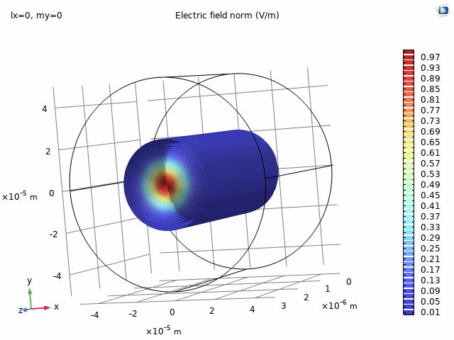<br><sub>moduł pola |E|</sub></td>
<td align="center">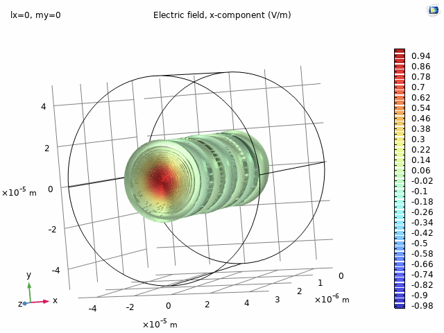<br><sub>składowa Ex</sub></td>
</tr>
</table>

- W każdej klatce widać **(lx+1)·(my+1) plam** ułożonych w prostokątną siatkę, z liniami węzłowymi tam, gdzie zerują się wielomiany $`H_{lx}`$ i $`H_{my}`$. Zgadza się to z teorią z rozdz. 1.3.
- Na wykresie Ex sąsiednie plamy mają **przeciwne znaki** (czerwony i niebieski), czyli na każdej linii węzłowej faza skacze o π.
- Wzdłuż z poprzeczny profil się nie zmienia, bo h = 3 µm ≪ z₀ = 314 µm. Izopowierzchnie modułu pola to proste „rury”. Na wykresie Ex widać warstwy powtarzające się wzdłuż z: to nośna $`e^{-ik_0z}`$ o okresie λ, która w module pola znika.
- Maksimum |E| rośnie z rzędem: ok. 1 V/m dla HG(0,0), 14,6 V/m dla HG(0,4) i ok. 222 V/m dla HG(4,4). To efekt braku normalizacji (H₄(u) zawiera 16u⁴). Mody w tym modelu nie niosą tej samej mocy. Do porównań ilościowych trzeba dodać czynnik $`1/\sqrt{2^{l+m}\,l!\,m!}`$.

#### 3.1.2. Wpływ rozmiaru siatki (HG(3,3), `zdj/mesh_topology`)

<table>
<tr>
<td align="center">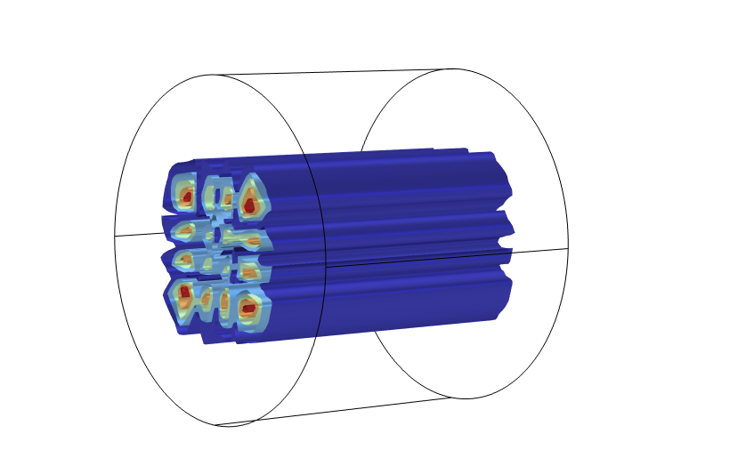<br><sub>Extremely coarse, |E|</sub></td>
<td align="center">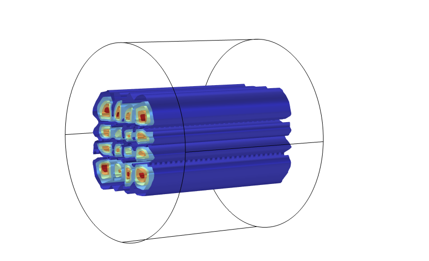<br><sub>Normal, |E|</sub></td>
<td align="center">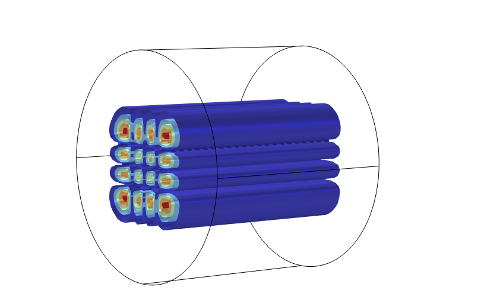<br><sub>Finer, |E|</sub></td>
</tr>
<tr>
<td align="center">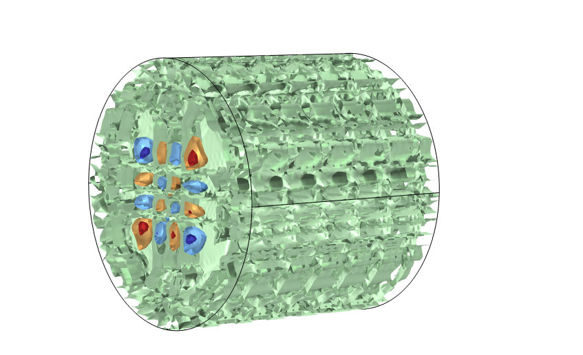<br><sub>Extremely coarse, Ex</sub></td>
<td align="center">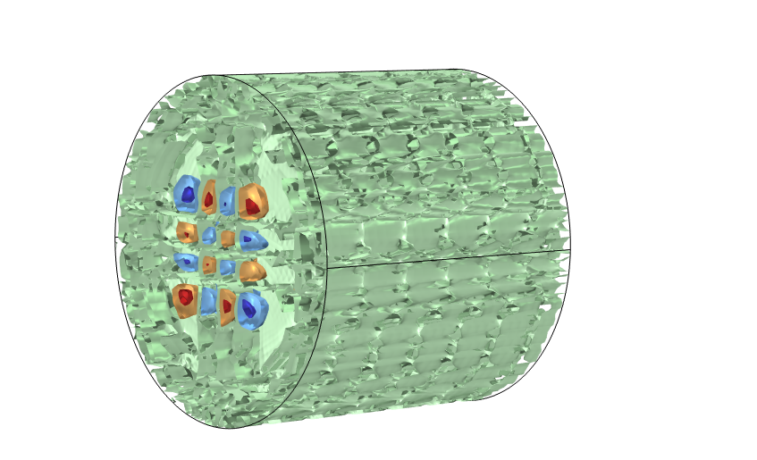<br><sub>Normal, Ex</sub></td>
<td align="center">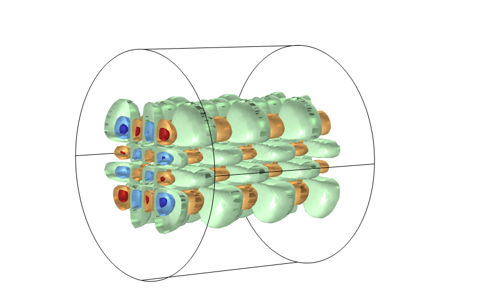<br><sub>Finer, Ex</sub></td>
</tr>
</table>

Pełna seria (9 ustawień, od *Extremely coarse* do *Extremely fine*) jest w `zdj/mesh_topology/`.

- *Extremely coarse*, *Extra coarse* i *Coarser* dają **identyczny wynik** (pliki obrazów są identyczne bajt w bajt), więc w tym zakresie ustawienie nie zmienia rozwiązania.
- Na grubych siatkach (do *Coarse*) plamy są zniekształcone: mają kanciaste, „trójkątne” przekroje, a środkowe są nierówne. Izopowierzchnie Ex wypełniają cały obszar szumem numerycznym.
- Od *Fine* wzwyż widać regularną siatkę 4×4 okrągłych plam i gładkie izopowierzchnie. Każde kolejne zagęszczenie zmienia obraz coraz mniej (*Normal → Fine → Finer → Extra fine*). Obraz *Extremely fine* zapisano z innym kadrem, więc porównuje się go tylko wizualnie.
- Izopowierzchnia Ex na poziomie bliskim zeru jest bardzo czuła na mały szum poza wiązką (pojawia się nawet przy *Extra fine*). O jakości rozwiązania lepiej świadczą kształty plam i moduł |E|, który od *Fine* w górę wygląda tak samo.

**Wniosek:** dla HG(3,3) wystarcza siatka *Fine* lub gęstsza.

#### 3.1.3. Liczba elementów wzdłuż z (HG(3,3), `zdj/mesh_sideways`)

Seria `3x3_NI{1…10}_50` ma Nl = 1…10 elementów wzdłuż z przy Nt = 50 elementach poprzecznych. Seria `3x3_Nl_{1…6}` ma Nl = 1…6.

<table>
<tr>
<td align="center">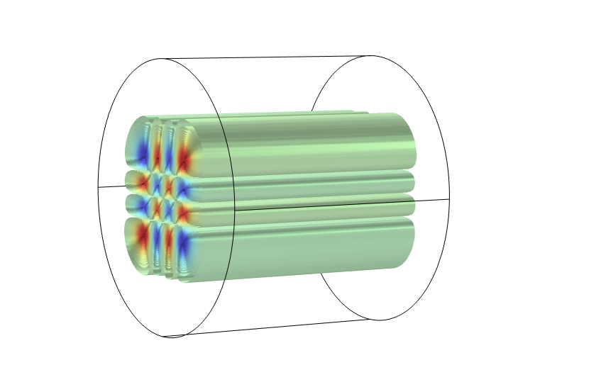<br><sub>Nl = 1, Nt = 50</sub></td>
<td align="center">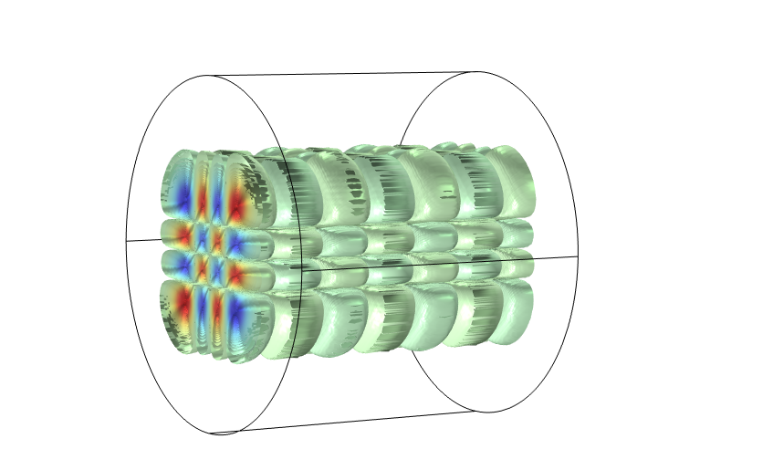<br><sub>Nl = 3, Nt = 50</sub></td>
<td align="center">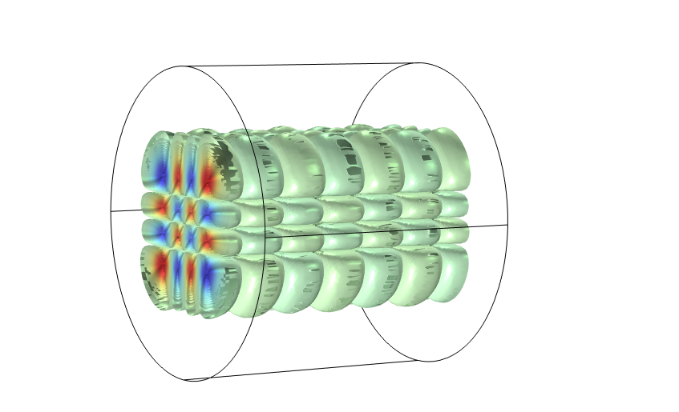<br><sub>Nl = 10, Nt = 50</sub></td>
</tr>
<tr>
<td align="center">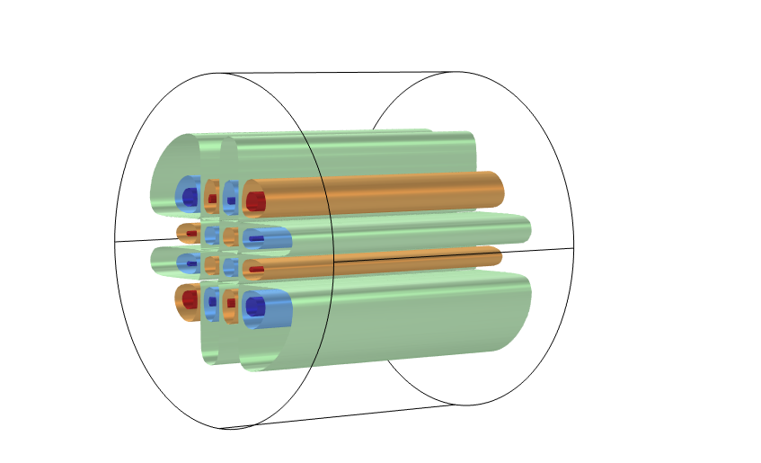<br><sub>Nl = 1</sub></td>
<td align="center">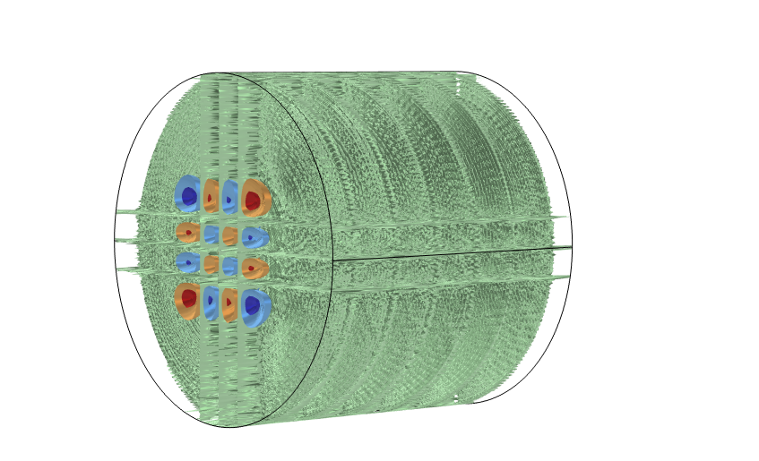<br><sub>Nl = 2</sub></td>
<td align="center">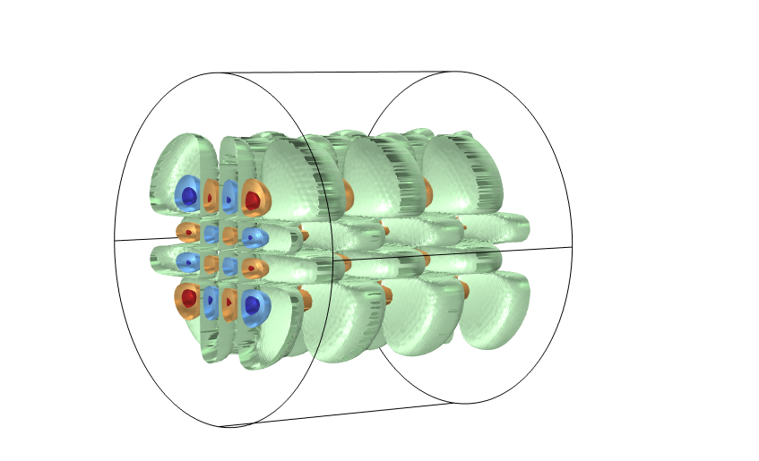<br><sub>Nl = 3</sub></td>
</tr>
</table>

- Przy **Nl = 1** izopowierzchnie to gładkie rury bez żadnej struktury wzdłuż z. Jeden element na całej długości obszaru nie odwzorowuje zmian pola w kierunku propagacji.
- Od **Nl = 2–3** pojawia się okresowa struktura wzdłuż z. Dalsze zagęszczanie stopniowo stabilizuje obraz: od ok. Nl = 7 kolejne klatki różnią się już nieznacznie.
- W serii `3x3_Nl_*` dla parzystych Nl (2, 4, 6) izopowierzchnia Ex bliska zeru wypełnia obszar szumem, a dla nieparzystych (3, 5) nie. Rozkład pola na powierzchni wejściowej jest poprawny we wszystkich przypadkach. Przyczyny tej zależności od parzystości nie zbadaliśmy.

Dzięki metodzie obwiedni kilka elementów kwadratowych na 3 µm (czyli na 3λ) wystarcza do poprawnego opisu propagacji. W sformułowaniu pełnofalowym potrzeba by kilku elementów na każdą długość fali.

#### 3.1.4. Ośrodek stratny: sweep n i κ (HG(3,3), `zdj/n_real`)

Każdy z sześciu GIF-ów `3x3_Nreal_and_Nim_<κ>.gif` ma stałe κ = `n_im` ∈ {0,5; 1; 1,5; 2; 2,5; 3}. Kolejne klatki to n = `n_real` = 0,5…3 z krokiem 0,25. Wykres pokazuje izopowierzchnie |E|.

<table>
<tr>
<td align="center">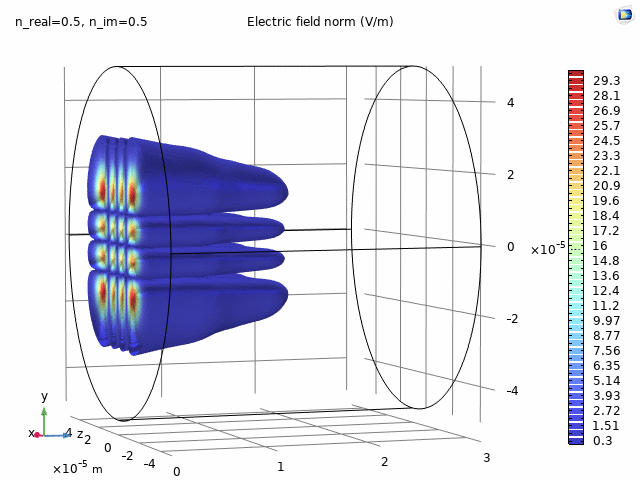<br><sub>κ = 0,5</sub></td>
<td align="center">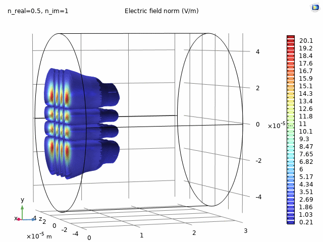<br><sub>κ = 1</sub></td>
<td align="center">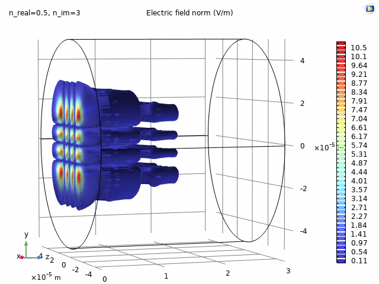<br><sub>κ = 3</sub></td>
</tr>
</table>

- We wszystkich przypadkach wiązka **zanika wzdłuż z**. Izopowierzchnie kończą się po ok. 1–1,5 µm, a najniższy poziom to ok. 1% maksimum. Profil poprzeczny (4×4 plamy) na wejściu się nie zmienia.
- Maksimum |E| przy wejściu zależy od n i κ, np. dla κ = 0,5 spada od 29,3 V/m (n = 0,5) do 21,3 V/m (n = 3).
- Teoria: amplituda maleje jak $`e^{-\kappa k_0 z}`$, więc pole spada do 1/e po drodze δ = λ/(2πκ). Daje to 0,32 µm dla κ = 0,5, 0,16 µm dla κ = 1 i 0,053 µm dla κ = 3. Dla κ = 0,5 zasięg izopowierzchni (spadek do 1% po ok. 4,6δ ≈ 1,5 µm) zgadza się z teorią. Dla κ = 3 pole powinno spaść do 1% już po ok. 0,24 µm, a izopowierzchnie sięgają ok. 1,2–1,5 µm.

> **Uwaga – ograniczenie modelu.** Wektor falowy obwiedni jest ustawiony na $`k_0`$ (próżnia) niezależnie od n. W ośrodku obwiednia musi więc sama opisać czynnik $`e^{-i(n-1)k_0z}\,e^{-\kappa k_0 z}`$. Przy siatce zapisanej w pliku (Nl = 5, czyli elementy po 0,6 µm wzdłuż z) te zmiany są dla dużych n i κ nierozdzielone. Dla n = 3 okres obwiedni to λ/(n−1) = 0,5 µm, a dla κ = 3 droga zaniku to 0,053 µm. Wyniki tej serii są więc **jakościowe**. Poprawa: ustawić `k1 = (0, 0, n_real*ewbe.k0)` i zagęścić siatkę wzdłuż z tak, żeby na drogę zaniku δ przypadało kilka elementów.

#### 3.1.5. Ośrodek anizotropowy (`zdj/orders/anisotropy`)

Oba GIF-y pokazują wszystkie 25 modów w ośrodku z anizotropowym (tensorowym) współczynnikiem załamania. Wartości składowych tensora nie są zapisane w pliku modelu w repo.

<table>
<tr>
<td align="center">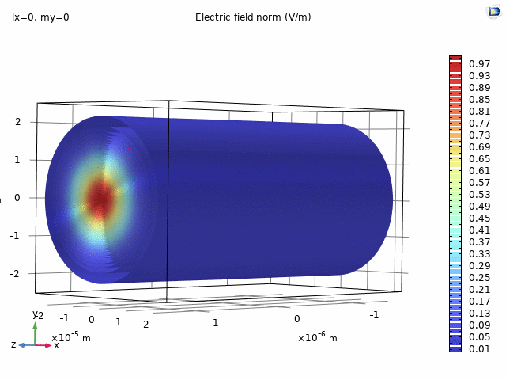<br><sub>wariant 1</sub></td>
<td align="center">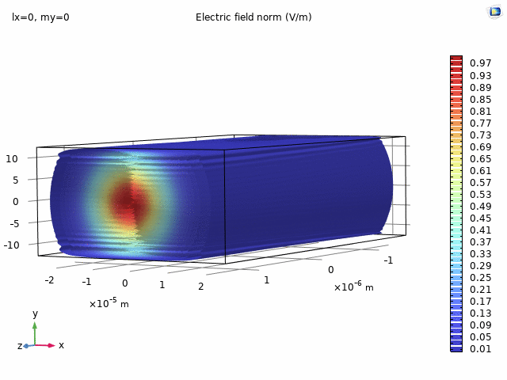<br><sub>wariant 2</sub></td>
</tr>
</table>

- **Wariant 1:** rozkład |E| i wartości maksymalne są praktycznie takie jak w ośrodku izotropowym (HG(2,2): 5,11 vs 5,21 V/m; HG(4,4): 220 vs 222 V/m). Pasuje to do tego, że pole spolaryzowane wzdłuż x oddziałuje głównie ze składową $`n_{xx}`$, a na drodze 3 µm struktura poprzeczna nie ma czasu się zmienić.
- **Wariant 2:** różnice są wyraźne. Plamy są wydłużone i prążkowane, a maksima różnią się od przypadku izotropowego (HG(0,2): 3,06 vs 2,25 V/m; HG(2,2): 7,04 vs 5,21 V/m; HG(4,4): 186 vs 222 V/m). Na wykresie widać też węższy zakres w kierunku y, więc zewnętrzne plamy leżą przy krawędzi pokazanego obszaru.

#### 3.1.6. Weryfikacja ilościowa (HG(2,3))

To jednorazowy test, którego nie zapisano w pliku: HG(2,3), λ = 1 µm, Nt = Nl = 7, obliczenie 21 s. Pole na wyjściu (z = h = 3 µm) porównano z rozwiązaniem analitycznym z rozdz. 1.3.

| Wielkość | Symulacja | Teoria | Różnica |
|---|---|---|---|
| $`\int\lvert E\rvert^2 dA`$ na wyjściu | 6,0210·10⁻⁸ V² | $`\pi w_0^2\cdot 192\,E_0^2`$ = 6,0319·10⁻⁸ V² | −0,2% |
| względny błąd L2 pola: wzór **z** fazą Gouya | 1,7% | – | – |
| względny błąd L2 pola: wzór **bez** fazy Gouya | 6,0% | – | – |
| faza Gouya z całki nakładania $`\arg\int E\,E_\text{an}^{*}\,dA`$ | 0,05737 rad | $`6\arctan(3/314{,}16)`$ = 0,05729 rad | 0,13% |

Symulacja odtwarza fazę Gouya $`(l+m+1)\zeta`$ z dokładnością 0,13%, chociaż na wejściu nie była narzucona (rozdz. 2.3). Moc jest zachowana z dokładnością 0,2%.

### 3.2. Wiązki Laguerre'a-Gaussa (m = 3, p = 0…3)

#### 3.2.1. Rozkład pola w przekroju poprzecznym

<p align="center">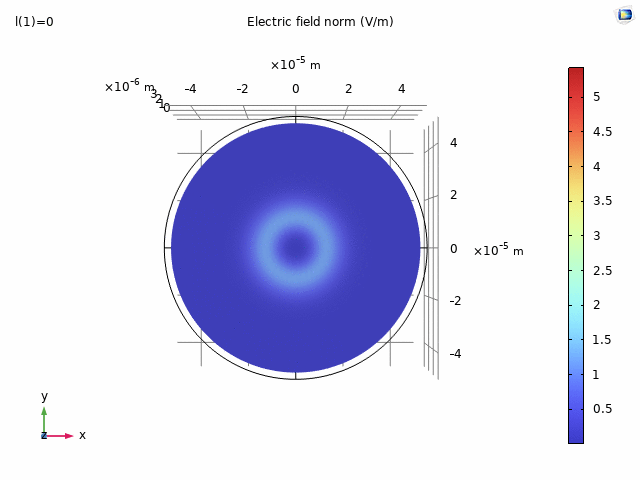</p>

- Na osi jest zawsze ciemny punkt: wir optyczny, pole ∝ r³.
- Liczba jasnych pierścieni wynosi **p+1**, czyli kolejno 1, 2, 3 i 4 dla p = 0…3, zgodnie z liczbą zer $`L_p^{3}`$.
- Dla p = 0 maksimum leży na r = w₀·√(|m|/2) ≈ 12,2 µm. Dla p = 1 ciemny pierścień jest na r = √2·w₀ ≈ 14,1 µm, bo $`L_1^{3}(x)=4-x`$ zeruje się dla x = 2r²/w₀² = 4.
- Maksimum |E| rośnie z p (1,16 → 4,80 V/m), bo pola, tak jak w HG, nie normalizujemy.

#### 3.2.2. Interferogram „widelec” (pochylona fala płaska, α = 15°)

<table>
<tr>
<td align="center">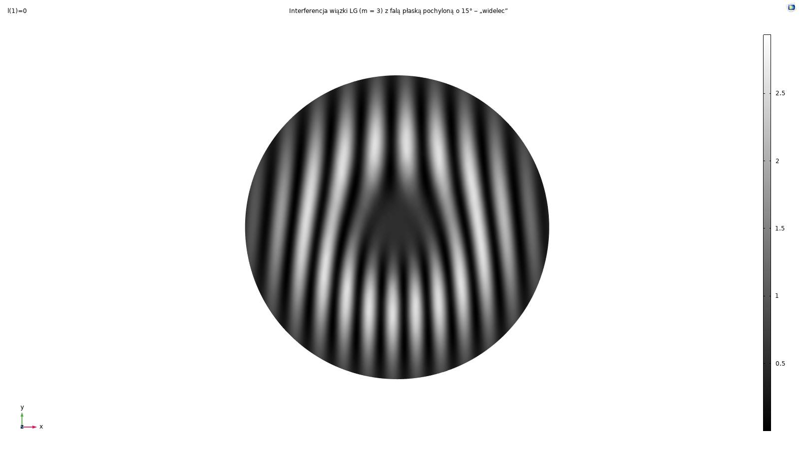<br><sub>p = 0</sub></td>
<td align="center">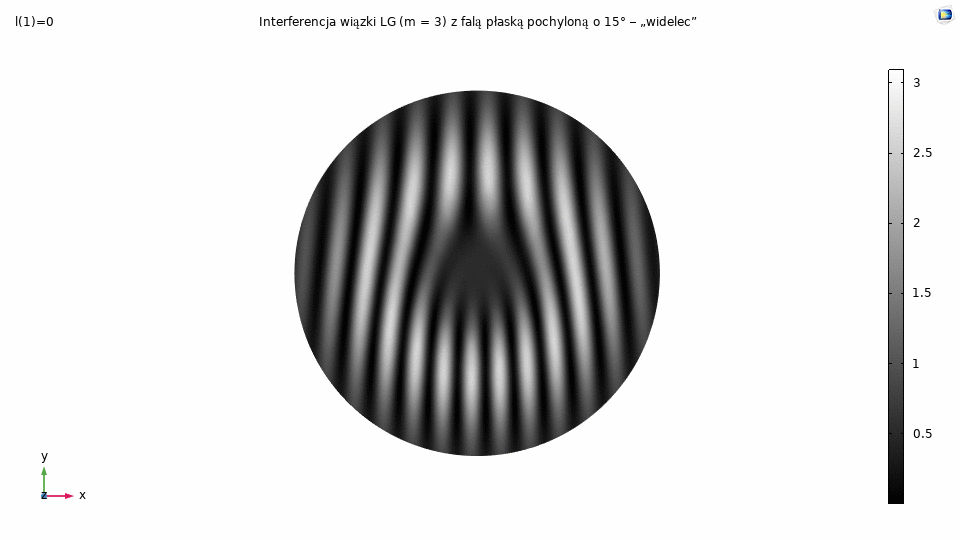<br><sub>p = 0…3</sub></td>
</tr>
</table>

- Daleko od osi prążki są proste i równoległe, z okresem ok. 3,9 µm (λ/sin 15°).
- W środku widać **widelec**: po jednej stronie osi są **3 prążki więcej** niż po drugiej, czyli 3 prążki kończą się w punkcie osobliwości. To bezpośredni pomiar ładunku topologicznego |m| = 3.
- Dla p > 0 na każdym ciemnym pierścieniu prążki przesuwają się o pół okresu, bo pole zmienia tam znak. Widać to jako „łamanie się” prążków na kolejnych okręgach.

#### 3.2.3. Interferogram „spirala” (współosiowa fala sferyczna, R = 80 µm)

<table>
<tr>
<td align="center">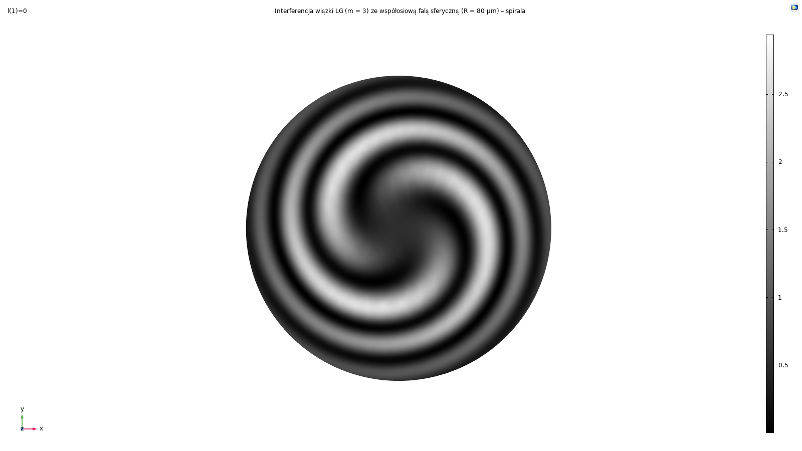<br><sub>p = 0</sub></td>
<td align="center"><br><sub>p = 0…3</sub></td>
</tr>
</table>

- Zamiast koncentrycznych pierścieni powstaje **spirala o 3 ramionach**, czyli |m| = 3.
- Dla p > 0 ramiona spirali przerywają się i przesuwają na ciemnych pierścieniach (skok fazy o π).

#### 3.2.4. Helikalny front falowy („korkociąg”)

<table>
<tr>
<td align="center">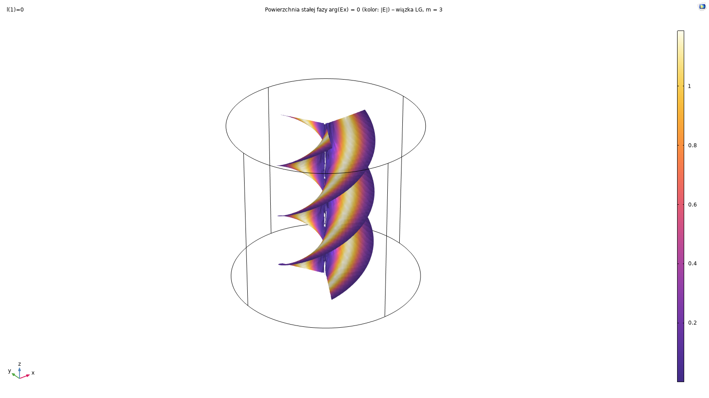<br><sub>powierzchnia arg(Ex) = 0, kolor: |E|</sub></td>
<td align="center">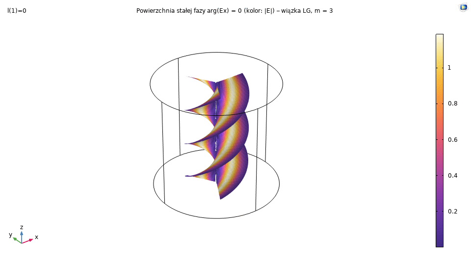<br><sub>zmiana fazy odniesienia 0 → 2π (jeden okres optyczny)</sub></td>
</tr>
</table>

- Powierzchnia stałej fazy arg(Ex) = 0 (dla r < 2,5 w₀) to **trzy splecione helikoidy**, zgodnie z warunkiem mφ − k₀z = 2πn dla m = 3. Każda helikoida wznosi się o mλ na jeden obrót, więc w obszarze h = 3λ wykonuje dokładnie jeden obrót. Oś z jest na wykresie rozciągnięta.
- Animację zrobiono przez rozszerzenie danych w fazie (24 klatki), co odpowiada upływowi czasu o jeden okres optyczny. „Korkociąg” obraca się wokół osi, czyli równoważnie przesuwa się wzdłuż z o λ. To obrazowa postać helikalnego frontu falowego niosącego OAM.

#### 3.2.5. Orbitalny moment pędu na foton

<p align="center">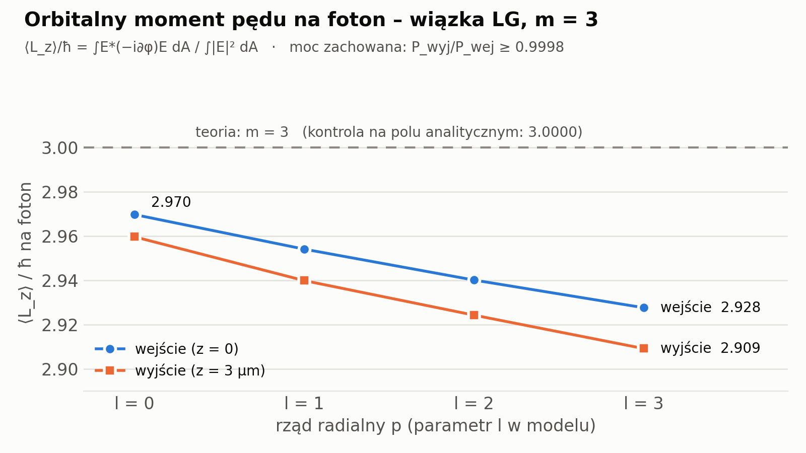</p>

| p (`l`) | ⟨L_z⟩/ħ na wejściu (z = 0) | ⟨L_z⟩/ħ na wyjściu (z = 3 µm) | P_wyj / P_wej | kontrola: pole analityczne |
|---|---|---|---|---|
| 0 | 2,9697 | 2,9597 | 0,99997 | 3,0000 |
| 1 | 2,9541 | 2,9399 | 0,99993 | 3,0000 |
| 2 | 2,9402 | 2,9243 | 0,99989 | 3,0000 |
| 3 | 2,9277 | 2,9092 | 0,99983 | 3,0000 |

Dane źródłowe: [`laguerre/lg_oam/oam_na_foton.csv`](laguerre/lg_oam/oam_na_foton.csv).

- Kontrola na polu analitycznym, liczona tą samą kwadraturą na tej samej powierzchni, daje **3,0000** dla każdego p. Samo całkowanie jest więc dokładne, a odchylenia od 3 pochodzą z reprezentacji pola przez elementy skończone, głównie z pochodnej ∂E/∂φ.
- Na wejściu błąd wynosi 1,0% (p = 0) do 2,4% (p = 3). Rośnie z p, bo przy tej samej siatce poprzecznej struktura radialna staje się coraz drobniejsza.
- Na wyjściu wartości są niższe o 0,3–0,6%. To efekt numeryczny: w jednorodnym, izotropowym ośrodku OAM jest zachowany.
- Moc jest zachowana z dokładnością lepszą niż 0,02% (P_wyj/P_wej ≥ 0,99983), więc warunek dopasowania na wyjściu praktycznie nie odbija.
- Model odtwarza przewidywanie teorii: **OAM na foton wynosi m i nie zależy od rzędu radialnego p** (w granicach błędu siatki). Znak fizyczny jest opisany w rozdz. 1.5.

---

## 4. Wnioski

1. Metoda obwiedni (ewbe) pozwala policzyć propagację wiązek HG i LG w obszarze 100 µm × 3 µm, mając na długości obszaru tylko kilka elementów. Pole padające wystarczy zadać jako profil modu w przewężeniu.
2. Rozkłady pola zgadzają się z teorią: HG(l, m) ma (l+1)(m+1) plam z naprzemiennym znakiem, a LG(p, m) ma p+1 pierścieni i wir optyczny na osi.
3. Faza Gouya wynika z rozwiązania, a nie z warunków brzegowych: dla HG(2,3) zmierzono 0,05737 rad przy teoretycznych 0,05729 rad.
4. Interferogramy (widelec, spirala) i powierzchnia stałej fazy (korkociąg) bezpośrednio pokazują ładunek topologiczny m = 3. Całka OAM daje 2,91–2,97 przy teoretycznym 3, a błąd 1–3% wynika z dyskretyzacji.
5. Analiza siatki dla HG(3,3): wystarcza rozmiar *Fine* poprzecznie i kilka elementów wzdłuż z. Dla ośrodków o n ≠ 1 i dużym κ trzeba dopasować wektor falowy obwiedni i zagęścić siatkę (rozdz. 3.1.4).

## 5. Jak otworzyć i przeliczyć modele

- Potrzebny jest COMSOL Multiphysics 6.4 z modułem Wave Optics.
- **HG:** otwórz plik, w razie potrzeby zmień listę `lx`, `my` w *Parametric Sweep* i uruchom *Study 1 → Compute* (25 modów, ok. 1,5 min).
- **LG:** rozwiązania są już w pliku, więc wykresy i *Derived Values* działają od razu. Po dodaniu nowych operatorów w *Definitions* trzeba wykonać *Study 1 → Update Solution* (bez ponownego liczenia).
- Plik LG ma ok. 98 MB, a GitHub odrzuca pliki większe niż 100 MB. Przed commitem modelu z dodatkowymi rozwiązaniami trzeba je wyczyścić.

## 6. Źródła

1. B. E. A. Saleh, M. C. Teich, *Fundamentals of Photonics*, 2nd ed., Wiley, 2007, rozdz. 3 (*Beam Optics*): wiązka Gaussa, wiązki Hermite'a-Gaussa i Laguerre'a-Gaussa (wzór 3.4-1).
2. K. Tarnowski, *Wybrane zagadnienia fotoniki*, wykład 3: ewbe, propagacja wiązki gaussowskiej wyższego rzędu. PWr, 2026/27.
3. K. Tarnowski, *Wybrane zagadnienia fotoniki*, laboratorium 4: *Propagacja wiązek światła strukturyzowanego*. PWr, 2026.
4. COMSOL Wave Optics Module Application Library: *Orbital Angular Momentum Beam* (`orbital_angular_momentum.mph`).
5. L. Allen, M. W. Beijersbergen, R. J. C. Spreeuw, J. P. Woerdman, „Orbital angular momentum of light and the transformation of Laguerre-Gaussian laser modes”, *Phys. Rev. A* **45**, 8185 (1992).
